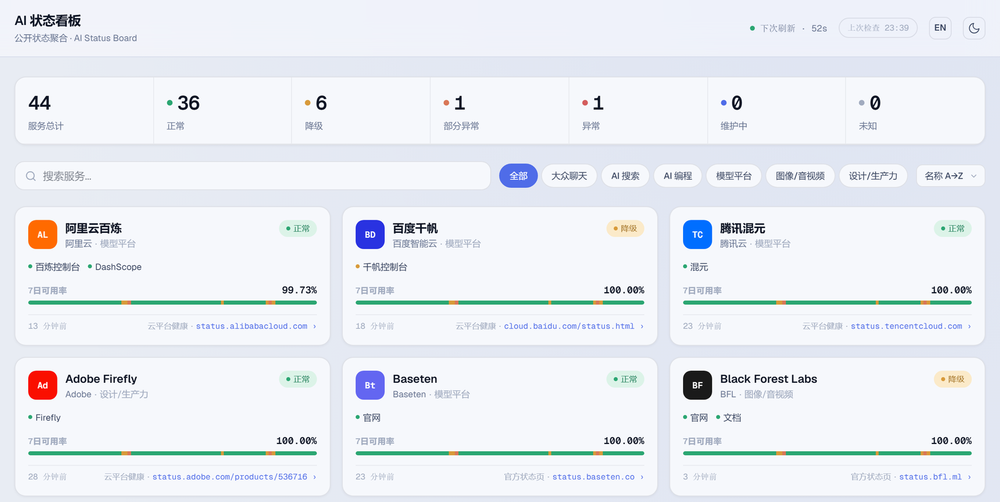

# is-ai-down

[中文](./README.zh-CN.md)

ChatGPT won't load. Is it down, or is it just you? This page answers that for the common AI services in one place.

Live: https://is-ai-down.yoru-and-akari.dev



## What it does

- Pulls in the official status pages of AI products and the infrastructure behind them.
- For services without their own status page, checks whether their public pages are reachable.
- Shows every service's status in the same format, along with recent incidents and the health of public endpoints.
- Has a small feedback form, so you can report a missing service or a result that looks wrong.

## What a green light means

The data does not come from inside the AI companies. Green means the public status page or endpoint looked healthy when it was checked. Login, billing, model responses, access from your region, or any single feature could still be broken.

This is a personal project, provided as is. There is no SLA and no operational or legal guarantee.

## How it's built

```text
Browser
  ↓
Cloudflare Edge
  ↓
Cloudflare Worker
  ├─ /api/services
  ├─ /api/incidents
  ├─ /api/stats
  └─ /api/feedback
  ↓
Cloudflare D1
```

The frontend is a Next.js 16 static export, served by Cloudflare Worker Assets. The backend is a Cloudflare Worker that polls on a schedule and serves the API. Data lives in a Cloudflare D1 database.

## Run it locally

Frontend:

```bash
cd web
npm install
npm run dev
```

It runs on http://localhost:3000.

Backend:

```bash
cd worker
npm install
npx wrangler dev --port 8788
```

It runs on http://localhost:8788. In local development, `web/.env.development` points the frontend at this Worker port.

## Where the data comes from

Official public status pages come first. When a product has no standalone status page worth reading, the board probes its public pages instead. Everything is put into one format for display. Treat it as a public signal, not a promise that a product works.

## Feedback

Use the feedback form on the live site, or open a GitHub Issue.

## License

GNU Affero General Public License v3.0. See [LICENSE](./LICENSE).

## Acknowledgements

Built together with Claude and Codex.
