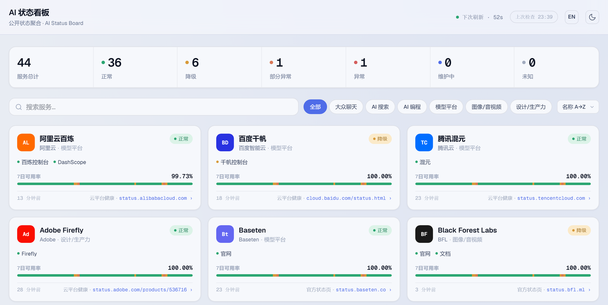

# is-ai-down

[English](./README.md)

ChatGPT 打不开，是它挂了，还是你这边的问题？常用的 AI 服务，这一个页面就能看清。

在线地址：https://is-ai-down.yoru-and-akari.dev



## 它做什么

- 汇总 AI 产品和底层服务商的官方状态页。
- 没有独立状态页的服务，就去看它的公开页面能不能打开。
- 所有服务的状态统一成一个格式显示，还有近期事件和公开接口的健康情况。
- 带一个小反馈表单。发现少了哪个服务，或者哪个结果看着不对，可以直接报。

## 绿灯代表什么

这些数据不是 AI 厂商内部的监控。绿色只说明检查那一刻，公开的状态页或接口看起来正常。登录、计费、模型回复、你所在地区能不能访问、某个具体功能，仍然可能出问题。

这是个人的公开项目，按现状提供。没有 SLA，也不提供运营或法律上的保证。

## 它是怎么搭的

```text
Browser
  ↓
Cloudflare Edge
  ↓
Cloudflare Worker
  ├─ /api/services
  ├─ /api/incidents
  ├─ /api/stats
  └─ /api/feedback
  ↓
Cloudflare D1
```

前端是 Next.js 16 静态导出，放在 Cloudflare Worker Assets 上。后端是一个 Cloudflare Worker，定时轮询，也负责 API。数据存在 Cloudflare D1 里。

## 本地跑起来

前端：

```bash
cd web
npm install
npm run dev
```

跑在 http://localhost:3000。

后端：

```bash
cd worker
npm install
npx wrangler dev --port 8788
```

跑在 http://localhost:8788。本地开发时，`web/.env.development` 会把前端的 API 指到这个 Worker 端口。

## 数据从哪来

优先用官方公开状态页。有的产品没有像样的独立状态页，就改为探测它的公开页面。所有数据统一格式后再展示。把它当作公开信号看，不代表产品一定能用。

## 反馈

用线上站点里的反馈表单，或者开一个 GitHub Issue。

## 许可证

GNU Affero General Public License v3.0，见 [LICENSE](./LICENSE)。

## 致谢

和 Claude、Codex 一起做的。
